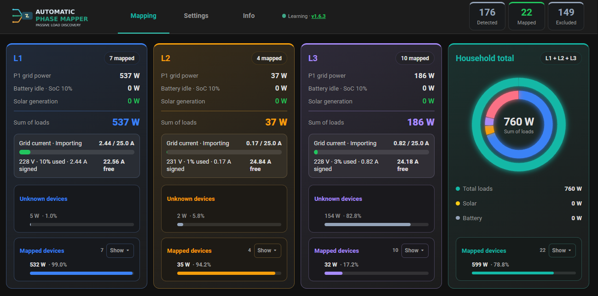
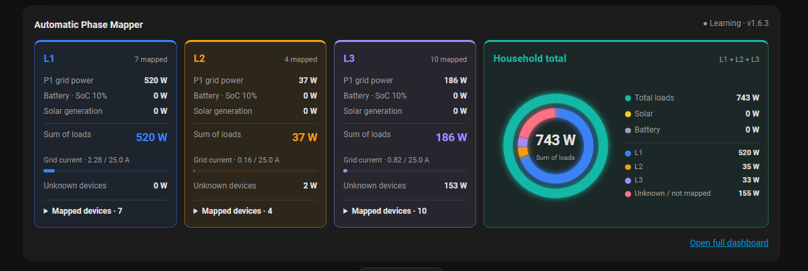
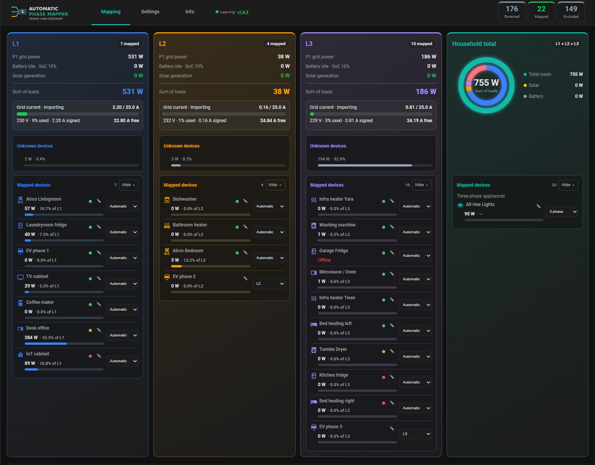
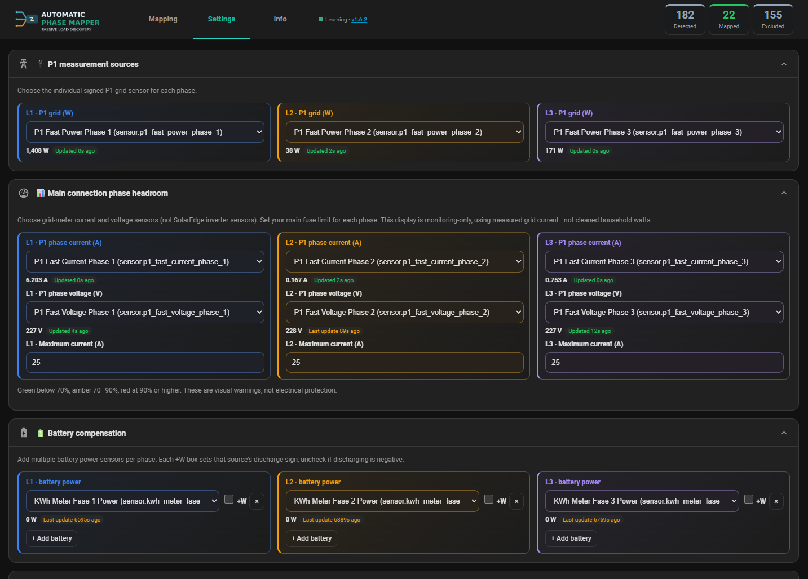
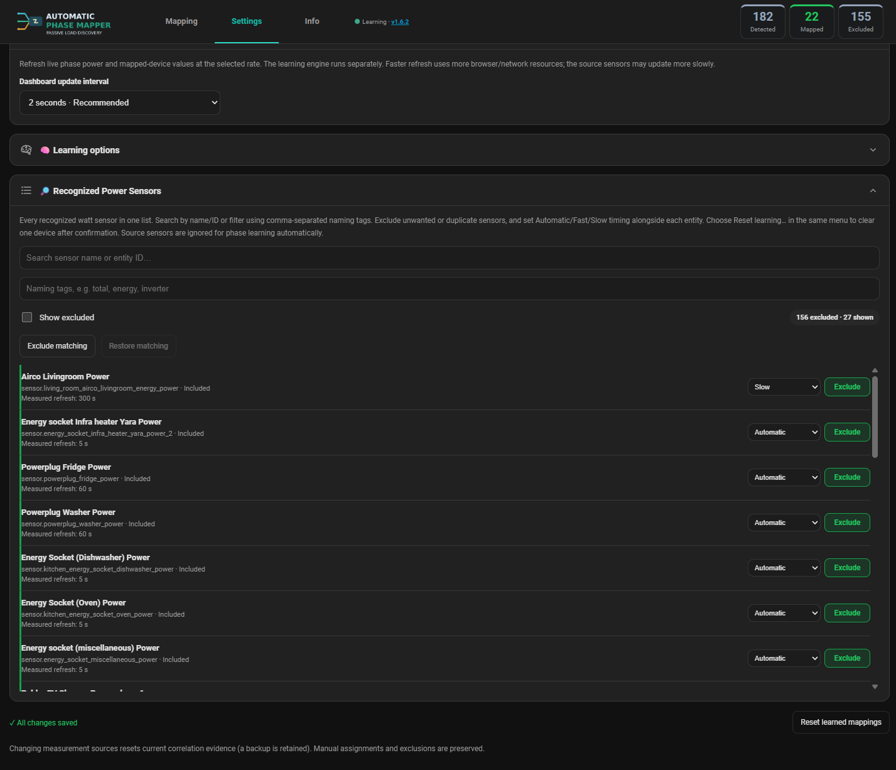
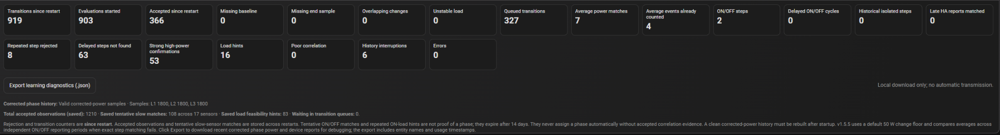

# Automatic Phase Mapper

**v1.6.3 Release Candidate 1 — responsive Lovelace card, more reliable layouts, and offline mapped-device visibility**

This release candidate includes the updated four-column Lovelace card (L1 : L2 : L3 : Household = **1 : 1 : 1 : 2**), compact household ring/legend layout, responsive behavior, custom device names and icons, and retained mapped devices when their power sensors become unavailable. The main Mapping cockpit has refined spacing, more stable refresh/alignment, and device-level **Offline** feedback.

**Status:** release candidate for Home Assistant testing. The phase-learning algorithm's core matching logic is unchanged. The latest source is being prepared on the `release/v1.6.3-rc1` branch; `main`/v1.6.2 remain the established baseline until approval.

**Before upgrading:** Back up Home Assistant (including `.storage`), and restart Home Assistant after replacing the integration. Do not delete the integration entry or stored learning data.

**Find out which electrical phase your Home Assistant devices are connected to — without manually tracing every circuit.**

Automatic Phase Mapper is an experimental, local Home Assistant integration that correlates individual device power changes with your three-phase grid measurements. Over time, it builds evidence for L1, L2 or L3 and presents the results in a dedicated dashboard.

**Candidate version:** `v1.6.3-rc1` (integration identifies as `1.6.3`) · **Status:** Experimental / candidate validation · **Designed for:** Three-phase Home Assistant installations

[Get started](#installation) · [Explore the dashboard](#a-dashboard-built-around-your-phases) · [Learn faster](docs/TROUBLESHOOTING.md#help-a-low-power-or-slow-device-learn-faster) · [Troubleshooting](docs/TROUBLESHOOTING.md) · [Release notes](RELEASE_NOTES.md) · [Report an issue](https://github.com/niCNCo/HA-auto-device-phase-mapping/issues)

## Why use it?

You probably already have power sensors for your appliances, smart plugs or EV charger. You may also have a three-phase P1 meter. What is missing is the link between them: **which appliance contributes to which phase?**

Automatic Phase Mapper helps discover that link by observing matching increases and decreases in power consumption. It works passively: **no switching or controlling devices is required for normal learning**.

- **Automatic device-to-phase learning** — collects evidence for L1, L2 and L3 instead of requiring manual phase assignments.
- **Confidence and transparency** — see device-specific evidence, confidence indicators, and items that are still learning.
- **Designed for real sensor timing** — supports fast-reporting plugs and slower or variable loads, including air conditioners and heat pumps.
- **Live power breakdown** — phase-by-phase grid power, mapped loads, unknown residual power and household totals.
- **Battery and solar compensation** — configured production and battery measurements help isolate household load from grid readings.
- **Persistent evidence** — learning observations are saved across Home Assistant restarts.
- **Detailed diagnostics** — inspect accepted matches, queued transitions, correlation attempts and history quality.

> **What it does not do:** It does not physically measure your wiring or prove that an assignment is electrically correct. Confidence scores describe algorithmic evidence, not a certified circuit check. Phase current/headroom is monitoring only — **not** electrical protection or load balancing.

## The Lovelace card — 1:1:1:2 responsive overview

The compact Lovelace overview gives each of L1, L2 and L3 one share of the row and **Household total two shares** when there is enough room. The household ring and its totals, color-coded phase breakdown, and unknown/unmapped load appear together. At intermediate widths, the percentages are hidden first while wattages and labels remain; at smaller widths, cards reflow for readability. Use the card editor to select Compact or Detailed view.

## A dashboard built around your phases

### 1. Mapping — the big picture

See L1, L2 and L3 side by side, with live P1 data, mapped device power, remaining unknown consumption and total household load. Expand each phase to see the appliances associated with it.

### 2. Devices — mapped and still learning

Expand a phase to inspect its mapped devices, edit names/icons, or choose a manual phase override. A previously mapped power sensor that becomes `unavailable` or `unknown` remains in its learned phase list and count; its power field shows **Offline** in regular red text instead of a misleading wattage. It returns to live wattage automatically when its sensor recovers. Offline readings are excluded from the live summed power. The settings page also provides recognized/unmapped-device controls.

### 3. Settings — connect your measurement sources

Choose the signed **P1 grid power sensor (W)** for each phase. Optionally add current (A), voltage (V), main fuse limits, solar production and battery power sensors so the dashboard can account for generation and storage.

### 4. Settings — keep the device list clean

Use **Recognized Power Sensors** to exclude duplicates or irrelevant measurements, search by name or entity ID, and choose Automatic / Fast / Slow timing for individual devices. Keep aggregate meters and individual device readings from being counted twice.

### 5. Learning diagnostics — see what is happening

Diagnostics expose transitions, evaluations, accepted matches and unsuccessful attempts. They are useful for understanding slow learning and checking sensor health without guessing.

**About queued transitions:** The "Queued transitions" counter is cumulative since restart, **not** the current queue length. Look at "Waiting in transition queues" to see active backlog. See the [diagnostics guide](docs/USER_GUIDE.md#understanding-learning-diagnostics).

## Installation

### Manual installation

1. Back up your Home Assistant configuration, including `.storage`.
2. Copy the **`custom_components/ha_auto_device_phase_mapping`** folder from this repository into your Home Assistant `/config/custom_components/` folder.
3. Restart **Home Assistant itself** (a browser refresh is not sufficient for Python code changes).
4. Go to **Settings → Devices & services → Add integration** and search for **HA Auto Device Phase Mapping**.
5. Open the **Phase Mapper** sidebar view and select your L1, L2 and L3 signed P1 power sensors under **Settings**.
6. Review recognized sensors; exclude aggregate meters, duplicates and irrelevant readings. Allow the integration to collect evidence as appliances operate.

### HACS

For a repository that HACS can access, add this repository as a **custom repository** of type **Integration**, then download it and restart Home Assistant. This is **not yet a listing in the default HACS catalog**. Private-repository access depends on your HACS/GitHub setup; for a private beta, manual installation is the dependable fallback.

**Updates:** Replace the integration folder, restart Home Assistant and reload the frontend (fully reopen the Companion app if necessary). **Do not delete the integration or `.storage`** when upgrading. Check that the frontend and backend versions agree in Learning Diagnostics.

## Help it learn faster

Some low-power appliances produce changes too small or too infrequent to match reliably. If a device is powered through a **properly rated plug-in energy-monitoring socket**, you can temporarily connect a more obvious load — such as a hairdryer — to **that same socket** and switch it ON/OFF a few times. The integration still needs to observe a clean, matching change in both the device sensor and the P1 phase reading.

**Use safe timing:** Leave each ON and OFF state in place for at least several sensor report intervals; 10 seconds is only reasonable for sensors updating every 1–2 seconds. For 5-second sensors, start around 20–30 seconds per state; for 60-second sensors use longer intervals or simply let natural learning continue. Do **not** repeatedly short-cycle a hairdryer beyond the manufacturer's instructions, overload the plug, or use a hairdryer as a test on fixed wiring. Never move the smart plug to a different socket or circuit during the test.

See [the practical step-by-step guide and safety notes](docs/TROUBLESHOOTING.md#help-a-low-power-or-slow-device-learn-faster).

## Documentation

| Guide | What it covers |
| --- | --- |
| [User guide](docs/USER_GUIDE.md) | Dashboard tabs, sensor selection, timing settings, confidence and diagnostics |
| [Troubleshooting](docs/TROUBLESHOOTING.md) | Not learning, low-power devices, safe test loads, odd readings, iOS display issues |
| [Release notes](RELEASE_NOTES.md) | Development history and detailed changes |
| [Publishing guide](PUBLISHING.md) | Maintainer publishing and release steps |

## v1.6.2 release highlights

This release focuses on **Home Assistant iOS Companion dashboard stability**: frequent live updates are patched into the existing view rather than rebuilding the entire page. Scroll position and expanded panels are better preserved. Learning and queue recovery build on v1.6.1 and remain unchanged in v1.6.2. Real-device and Companion app testing remains valuable.

Read the [v1.6.2 release announcement](docs/releases/v1.6.2.md).

## Feedback and contribution

This project is being tested in a real three-phase Home Assistant installation. If you find a reproducible issue or have a clear improvement, please [open a GitHub issue](https://github.com/niCNCo/HA-auto-device-phase-mapping/issues). When sharing diagnostics, review exports for entity names, timestamps or household-specific information first.

The integration is experimental and provided without any claim of certified electrical safety or guaranteed phase detection.
