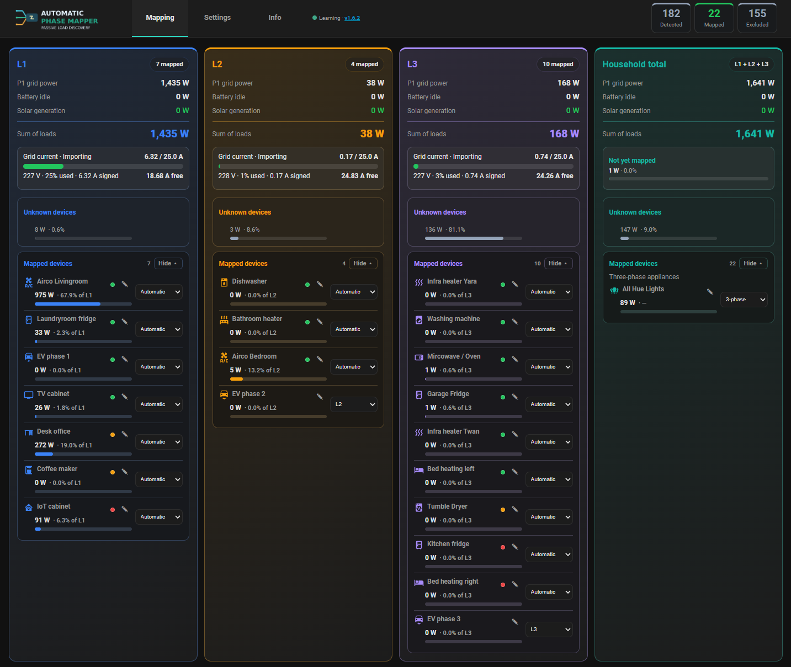
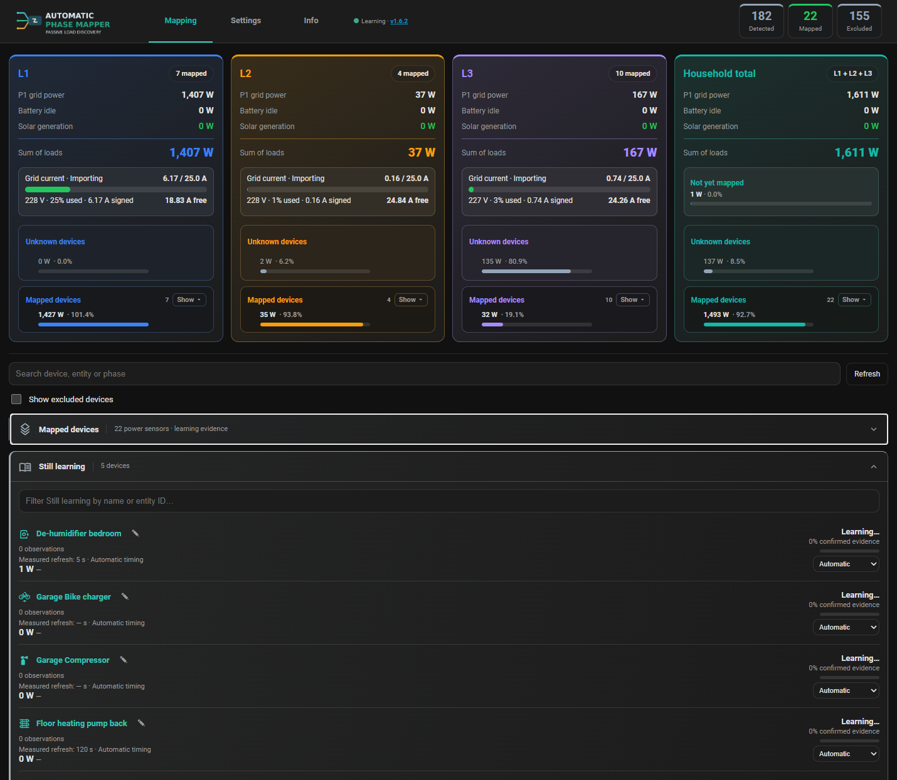
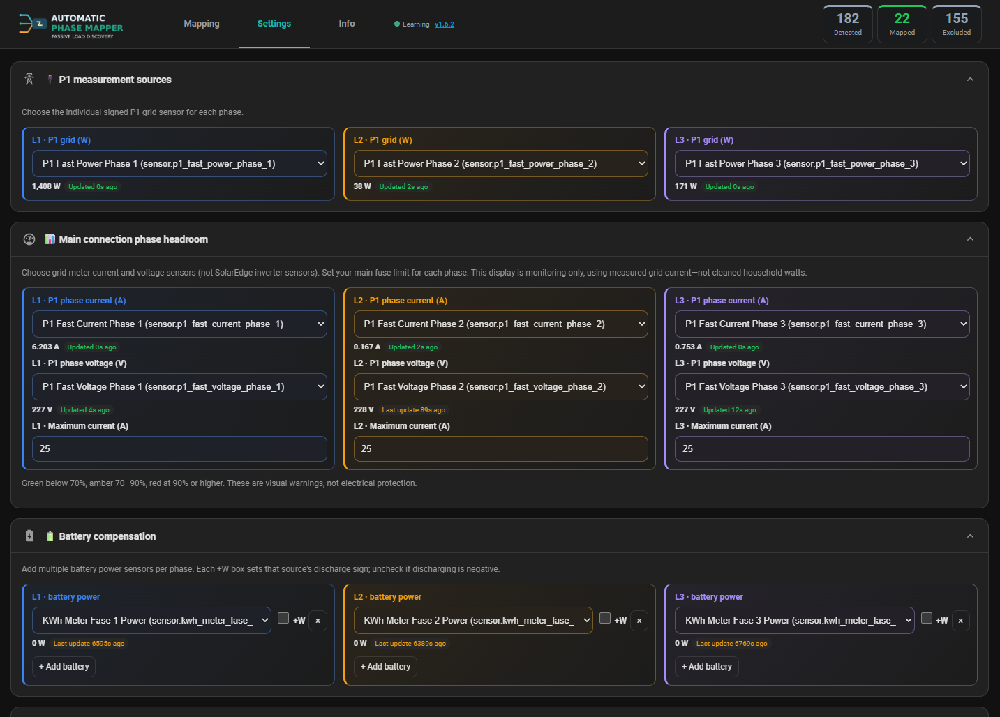
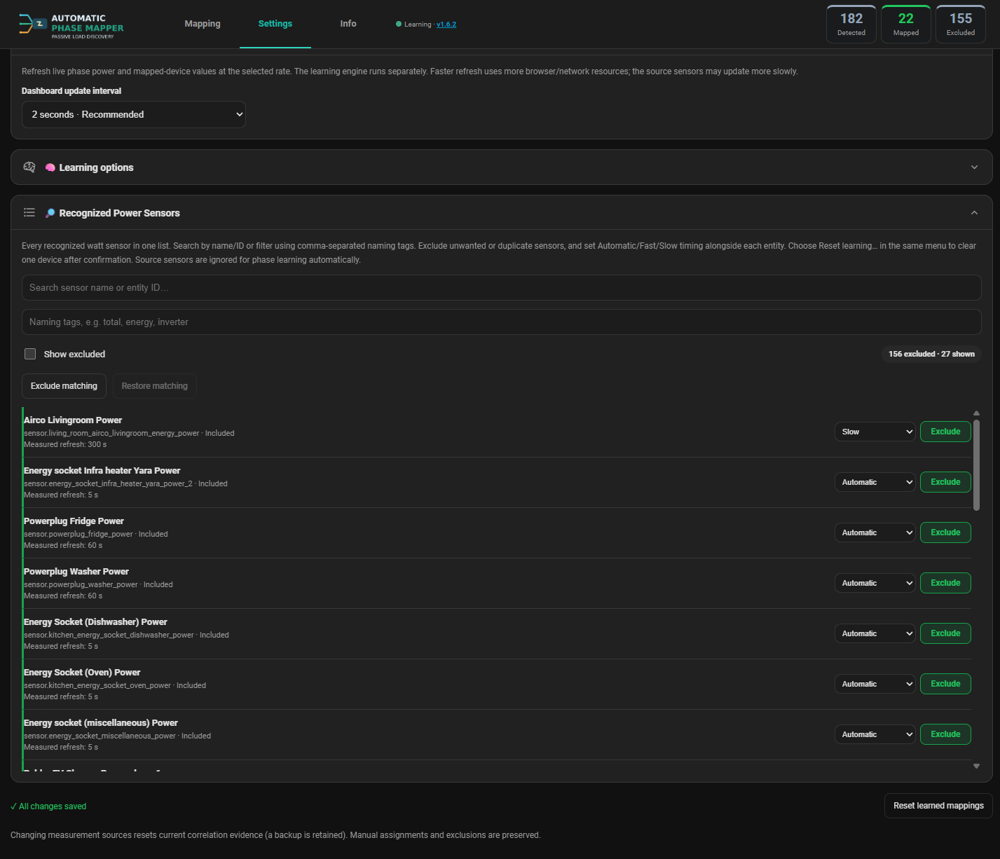
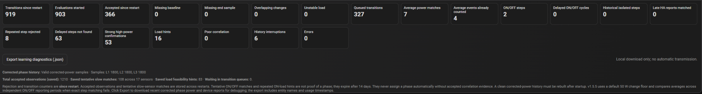

# Automatic Phase Mapper — User guide

[← README](../README.md) · [Troubleshooting](TROUBLESHOOTING.md)

## Mapping tab

The top four cards show L1, L2, L3, and Household total. Phase cards display:

- **P1 grid power:** live signed meter power for that phase, from the selected P1 sensor.
- **Battery idle / solar generation:** battery or PV contribution when correctly configured; zero can mean no active contribution or incomplete configuration.
- **Sum of loads:** estimated household load on the phase after the configured corrections.
- **Grid current:** measured phase amperage and remaining headroom relative to the entered limit; **monitoring only, not a protection system**.
- **Unknown devices:** remaining load not explained by currently mapped device readings. Because sensor update times differ and model confidence is statistical, this is an estimate rather than a perfectly reconciled electricity bill.
- **Mapped devices:** devices currently associated with that phase; expand to see the detailed entries.

Some device power readings will not line up perfectly with the P1 total at every moment: integration polling, negative grid power, solar, batteries and sensor update delays affect the snapshot.

### Device search and learning lists

Use the search field to find a particular device. The lists distinguish mapped power sensors from those still learning. Keep an eye on confidence/evidence trends rather than treating a green indicator as physical verification.

## Settings tab

### P1 measurement sources

Select the individual, **signed power (W)** sensor for each of L1, L2 and L3. Do not substitute a total household power sensor for one phase. Use grid-meter current and voltage sensors for headroom, not solar inverter readings. Set main connection current limits to the values that actually apply to your installation.

### Battery and solar compensation

When battery charge/discharge or PV generation changes, P1 grid power alone no longer equals household demand. Select appropriate per-phase or total sources, avoid duplicate counting, and verify the configured sign convention. Incorrect sources or inverted signs can create false correlations. Batteries/solar monitoring must represent actual physical connections and phase allocation.

### Recognized Power Sensors

Use the search and naming filters to review watt sensors. **Exclude** aggregate power readings and duplicate meters that would otherwise be learned as appliances. Automatic is generally the best timing choice. Override to Fast/Slow for sensors whose reporting behavior requires it; sensor *reporting cadence* matters more than how often the appliance switches on.

### What the timing setting does

- **Automatic:** lets Phase Mapper choose the appropriate correlation strategy based on sensor reporting behavior.
- **Fast:** for regularly updating, fairly prompt sensors. Useful for short distinct ON/OFF changes when reports arrive soon after physical changes.
- **Slow:** for delayed or variable consumption patterns, including some climate and Zigbee devices; evaluates longer patterns and delayed evidence.

For a slow-reporting sensor, rapidly switching a test appliance on and off may yield **no evidence at all** if the sensor misses the transitions. See [safe learning tests](TROUBLESHOOTING.md#help-a-low-power-or-slow-device-learn-faster).

## Info tab and version checks

The Info tab provides integration information. For updates, verify **frontend and backend versions** in Learning Diagnostics, especially after replacing integration files. The displayed version alone is insufficient if Python has not been restarted or the browser/app has cached older JavaScript.

## Understanding learning diagnostics

| Counter | Meaning / how to interpret it |
| --- | --- |
| Transitions since restart | Device power changes detected since this HA startup |
| Evaluations started | Transition evaluations begun since restart |
| Accepted since restart | Correlations accepted as learning evidence; not number of mapped devices |
| Queued transitions | **Cumulative** queued transitions, not currently waiting ones |
| Waiting in transition queues | Current pending work; a sustained nonzero value may merit investigation |
| Missing baseline / end sample | Incomplete measurements around a device transition |
| Overlapping changes / unstable load | Reasons a transition may be unsuitable for clear evidence |
| Delayed steps not found | Delayed correlation did not find a matching power step; not automatically a bug |
| Strong high-power confirmations | High-power electrical changes with convincing phase correlations |
| History interruptions | Sampling continuity lost, e.g., during restart/outage |
| Errors | Processing errors; investigate if nonzero and recurring |

Saved accepted observations can be **greater** than accepted since restart because evidence is retained across starts. The diagnostics export is useful for a reproducible issue; redact identifying entity names and timestamps if sharing publicly.

## Confidence is evidence, not certification

A reported 100% confidence means the learned scores strongly favor one phase in the available observations. It does not rule out duplicate sensors, inaccurate phase source configuration, correlated simultaneous loads, or unusual topology. For safety-critical decisions, verify phase/circuit placement independently.
