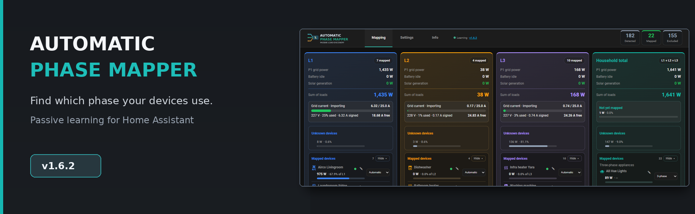
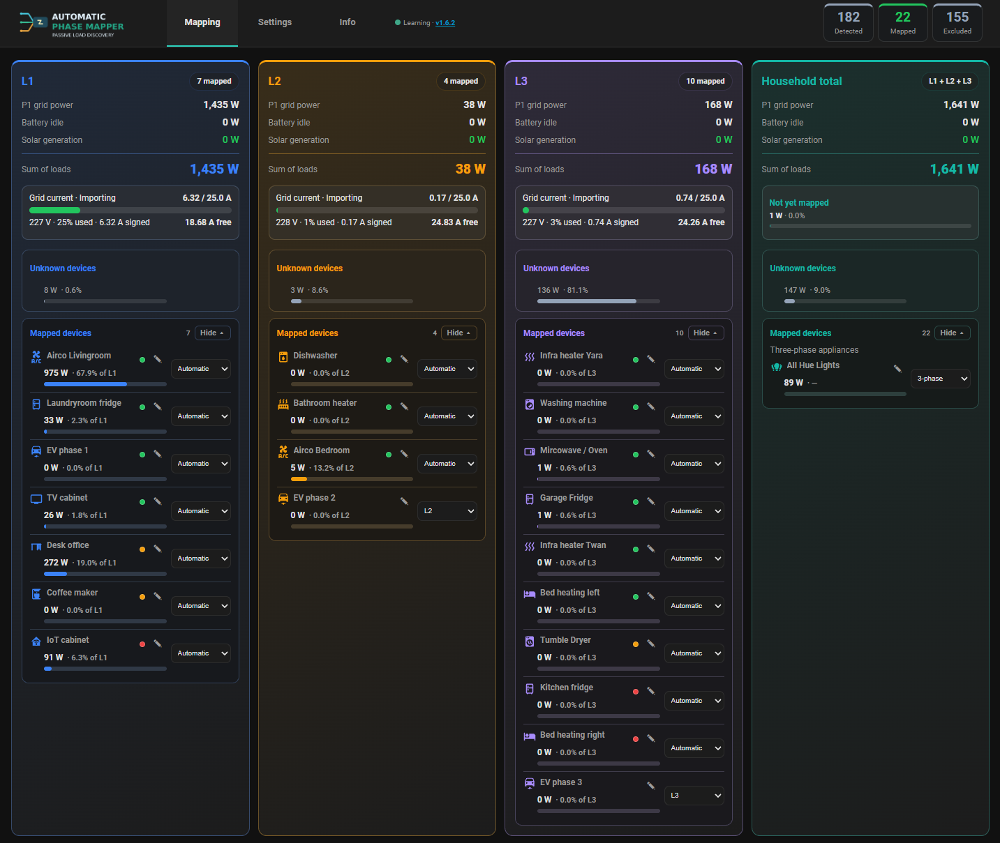
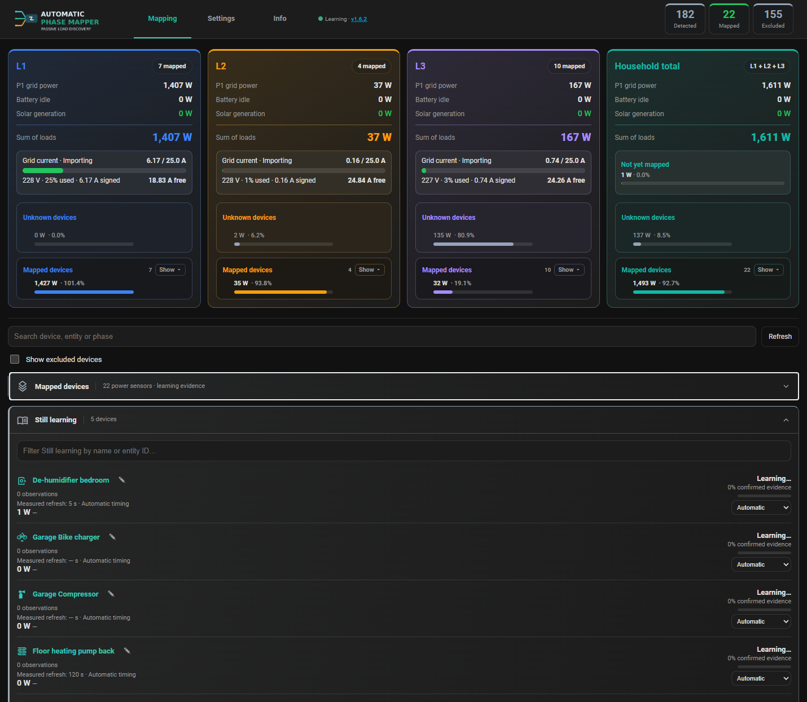
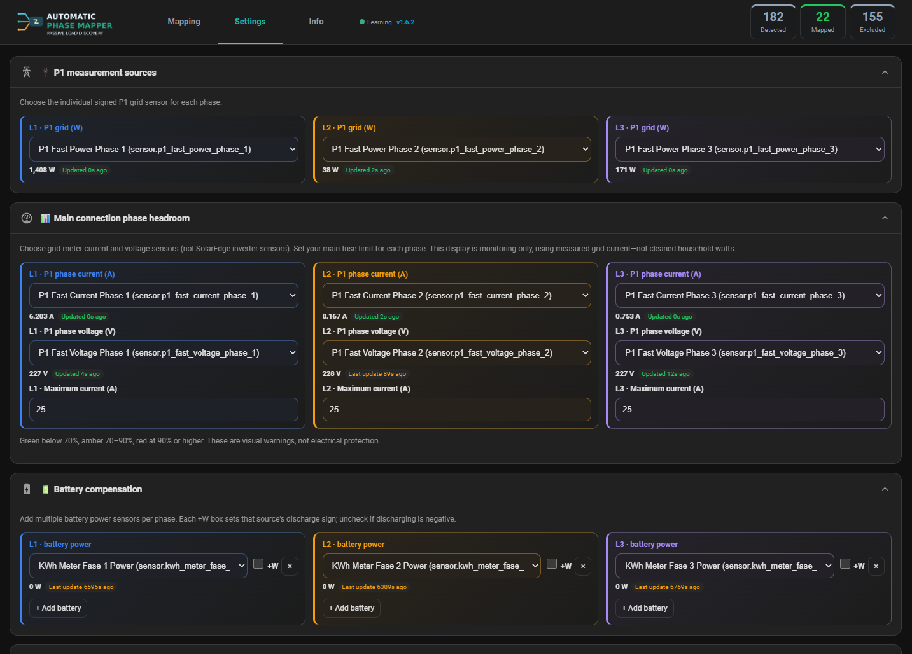
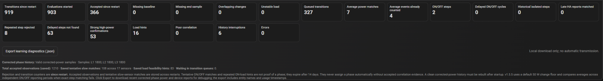

# Automatic Phase Mapper v1.6.2 — First GitHub release

> Passive device-to-phase discovery for three-phase Home Assistant installations.

**Automatic Phase Mapper** helps you discover which phase your devices use by comparing their measured power changes with L1, L2 and L3 grid readings. The more clean evidence it collects, the clearer its phase assignments become — without normal operation requiring manual switching or circuit tracing.

### Highlights

- **Automatic L1/L2/L3 detection** through correlation of device and P1 power changes.
- **Live phase dashboard** with mapped loads, unknown residual loads, household total and current headroom indicators.
- **Confidence and evidence** shown per device, plus a searchable list of devices still learning.
- **Automatic, Fast and Slow correlation modes** for different sensor reporting patterns.
- **Optional PV and battery compensation** to better isolate true household consumption.
- **Persistent learning and diagnostics** across Home Assistant restarts.
- **v1.6.2:** Smoother dashboard refresh and scroll behavior in the Home Assistant iOS Companion app, building on v1.6.1 queue-worker recovery.

### See it in action

**Mapping: live L1/L2/L3 dashboard**

**Device learning: mapped and still learning**

**Configuration: P1 phase sensors and compensation**

**Diagnostics: see what the learning engine is doing**

### Quick start

1. Back up your Home Assistant installation.
2. Copy `custom_components/ha_auto_device_phase_mapping` into `/config/custom_components/` (or add this repository in HACS as an accessible custom Integration repository).
3. Restart Home Assistant, then add **HA Auto Device Phase Mapping** under **Settings → Devices & services**.
4. Open the sidebar dashboard, configure your **signed P1 L1/L2/L3 power sensors**, and exclude duplicate or irrelevant power sensors.
5. Let the integration gather evidence through normal device activity.

For instructions and screenshots, see the [README](../../README.md) and [User guide](../USER_GUIDE.md).

### Troubleshooting tip

A low-power smart plug may not produce enough of a change to learn quickly. For a *suitably rated* plug-in energy-monitoring socket, a temporary test load at the **same outlet** may produce clearer ON/OFF steps. Allow each state to last multiple sensor reporting intervals — e.g., 10–15 seconds for a 1–2-second sensor, and 20–30 seconds for a 5-second sensor. Check equipment ratings and avoid rapid cycling; see the [full safe procedure](../TROUBLESHOOTING.md#help-a-low-power-or-slow-device-learn-faster).

### Notes

This is an **experimental integration**. Confidence is statistical evidence, not electrical circuit certification. Headroom is display-only, not overload protection. Back up `.storage` and do not delete your integration or learned history when upgrading.

**Full technical changes:** [RELEASE_NOTES.md](../../RELEASE_NOTES.md) · **Feedback:** [GitHub Issues](https://github.com/niCNCo/HA-auto-device-phase-mapping/issues)
