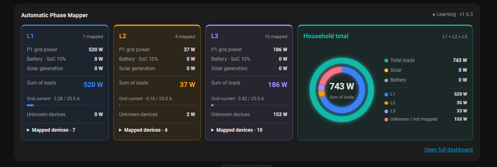
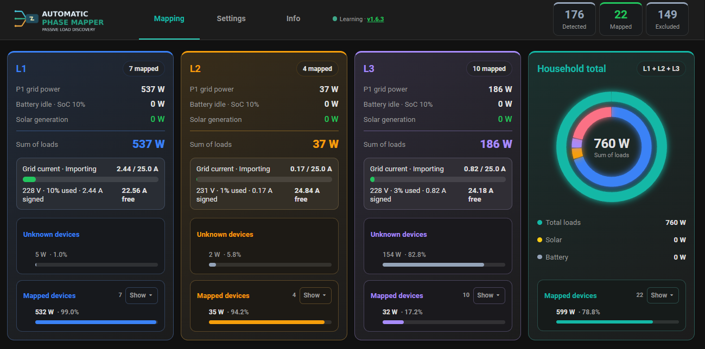
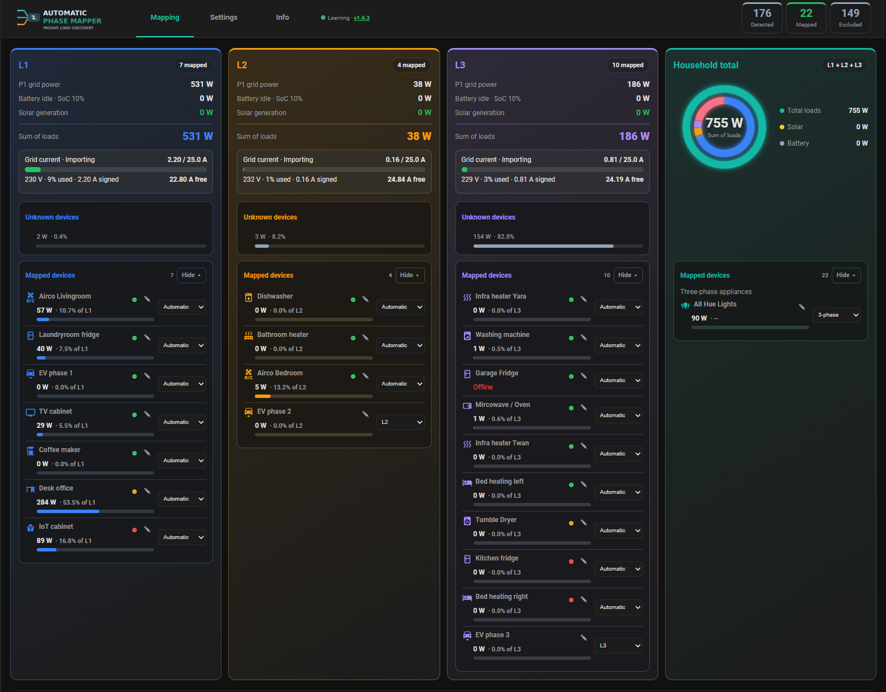

# Automatic Phase Mapper v1.6.3 RC1

**Pre-release / test candidate.** Do not treat statistical phase confidence as proof of electrical wiring.

## Highlights

- Four compact Lovelace tiles on desktop; 1:1:1:2 allocation, with Household total twice a phase tile.
- Ring and power/phase legends sit side by side in Household total.
- Graceful responsive resizing: hide phase percentages first, then reflow the tiles.
- Saved device names and icons in expanded Lovelace mappings.
- Temporarily unavailable mapped sensors remain listed with regular red **Offline** status.
- Better full-dashboard spacing, aligned mapped/unknown sections, stable visual refreshes and readable bars.
- No intentional changes to the learning engine or stored mappings.

## Installation and migration

Back up the Home Assistant configuration, including `.storage`. Replace the `custom_components/ha_auto_device_phase_mapping` folder, restart Home Assistant, fully reload the browser/Companion app, and check that frontend/backend versions agree. Do not delete the configuration entry or learned history. HACS access depends on repository visibility.

## Validation still required

162 Python tests passed. Remaining JavaScript test mismatches require review; the v1.6.3 RC1 should be evaluated on the actual Home Assistant dashboard, Lovelace, and iOS before final release.
